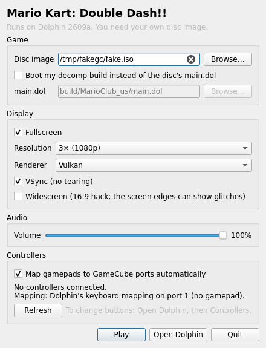

# Dolphin AppImage

A single Linux AppImage with [Dolphin](https://dolphin-emu.org) set up to boot Mario Kart: Double Dash!!.
It also boots a `main.dol` built from this decomp. It contains no game data, so you need your own disc image.

## Get it

Download it from [Releases](../../../releases), or build it yourself:

```sh
appimage/build.sh                 # for this machine's arch, result in build/
ARCH=aarch64 appimage/build.sh    # must run on an aarch64 machine
```

Needs `bash`, `curl`, `sha256sum`, `dpkg-deb` and a C and C++ compiler. No root, FUSE or docker.
`appimage/test-launcher.sh` tests the launcher (settings, `--game`, controller automap) without Dolphin,
a display or a controller.

## Use

```sh
./MKDD-Dolphin-*.AppImage                        # settings window: pick the disc image, then Play
./MKDD-Dolphin-*.AppImage --game                 # straight into the game, fullscreen
./MKDD-Dolphin-*.AppImage ~/games/mkdd.rvz       # start this disc image with the saved settings, and remember it
./MKDD-Dolphin-*.AppImage --dol                  # boot build/MarioClub_us/main.dol (run from the repo root)
./MKDD-Dolphin-*.AppImage --dol path/main.dol path/disc.iso
./MKDD-Dolphin-*.AppImage --pads                 # connected controllers and the ports they get
./MKDD-Dolphin-*.AppImage --dolphin              # plain Dolphin, e.g. to change controls
./MKDD-Dolphin-*.AppImage --help
```

- Escape quits the game (Dolphin's default Stop key). The game runs without Dolphin's main window, so
  quitting it ends the run.
- Without a display (e.g. over ssh) there is no window: the remembered disc starts, and the first time
  `zenity` or `kdialog` asks for it if the host has one.
- Dolphin uses the same folders as an installed Dolphin: settings in `~/.config/dolphin-emu`,
  saves in `~/.local/share/dolphin-emu`.

## Settings window



Starting the AppImage without arguments shows a few settings, the same flow as
[strikers-appimage](https://github.com/MichielMak/strikers-appimage): pick the disc image once, adjust what you
need, press Play. **Open Dolphin** opens Dolphin's full interface for everything else, such as remapping buttons.

| Setting | What it does in Dolphin |
|---|---|
| Disc image | the game to start |
| Boot my decomp build | starts your `main.dol` with the disc's files, like `--dol` |
| Fullscreen | `Display.Fullscreen` (`--game` always turns it on) |
| Resolution | `Settings.InternalResolution`: Auto, native, 2× to 6× |
| Renderer | `Core.GFXBackend`: Dolphin's choice, Vulkan or OpenGL |
| VSync | `Hardware.VSync` |
| Widescreen | `Settings.wideScreenHack` with a 16:9 aspect ratio |
| Volume | `DSP.Volume` |
| Map gamepads automatically | the controller automap below |

The choices are stored in `~/.config/mkdd-appimage/settings.ini` and passed to Dolphin with `-C` for that run
only. Dolphin's own settings, which an installed Dolphin shares, never change. `--forget` clears the disc.

## Steam and Steam Deck

Add the AppImage as a non-Steam game and set its launch options to `--game`. It then starts straight into
the game in fullscreen and ends when you quit the game (Escape, or Steam's own Exit game). Pick the disc once
in the settings window first, in desktop mode; if no disc is set, `--game` shows the window to ask for one.

## Controllers

Gamepads connected when you start a game are mapped automatically: the first one to GameCube port 1,
the next to port 2, up to 4. That gives local multiplayer with no setup. Without a gamepad, the keyboard
is port 1 (Dolphin's default keys).

| GameCube | Gamepad |
|---|---|
| A, B, X, Y | bottom, left, right, top face button (GameCube positions) |
| Z | right shoulder (RB / R1) |
| L, R | left and right trigger, analog |
| Control stick, C stick | left stick, right stick |
| D-pad, Start | D-pad, Start |

Plugging in while Dolphin runs works too:

- A pad that was there at start can be unplugged and plugged back in at any time, even mid-race.
  Dolphin finds it again by name.
- A new pad gets the first free port right away, and you get a notice (`notify-send`, and in the terminal).
  Quit the game and start it again to use it: Dolphin reads the mapping when a game starts, not while it
  runs.
- When at least one pad was connected at start, ports 2-4 are on for the whole run and show as unplugged
  until a pad takes them. Without any pad at start they stay off, so the first pad plugged in later gets
  port 1 and a second one needs Dolphin to be started again.

The mapping stays yours once you change it: remap anything in `--dolphin`, Controllers, and automap leaves
`GCPadNew.ini` alone from then on. It also leaves alone a mapping you had made before, and does nothing when
port setup uses Dolphin's GameCube adapter support. `--no-automap` (or `MKDD_AUTOMAP=0`) skips it for one run.

How it works:

1. Dolphin ties a mapping to one device name, such as `SDL/0/Xbox Series X Controller`, so a fixed config only
   works for the controller it was made with.
2. `mkdd-pads` (`appimage/pads.c`) uses the AppImage's own SDL3 with Dolphin's SDL hints, so it lists controllers
   under exactly the names Dolphin will give them.
3. The launcher writes one `[GCPadN]` section per gamepad into Dolphin's `GCPadNew.ini`, changing only those keys.
   Ports 2-4 are turned on with `-C Dolphin.Core.SIDeviceN=6`, which lasts for that run only.
4. Dolphin rewrites `GCPadNew.ini` at every start, so a marker comment would not survive. The launcher keeps a copy
   of what it wrote in `~/.config/mkdd-appimage/GCPadNew.written.ini`. If any of those keys differ next time, you
   remapped, and automap stops.
5. A keyboard-only `GCPadNew.ini` (Dolphin's default) is backed up before the first write and put back when no
   gamepad is connected.
6. Hotplug: the launcher runs Dolphin as a child instead of replacing itself with it, and starts
   `mkdd-pads --watch <Dolphin's PID>` next to it. That reports controllers coming and going (SDL's
   `JOYSTICK_ADDED`/`REMOVED`, with Dolphin's id numbering) and exits within half a second of Dolphin.
   A new gamepad's mapping is written like the others. Ports without a pad get a device that does not exist,
   so they read as unplugged; without a section Dolphin would put the keyboard on every port.
7. Dolphin can save the mapping it loaded at the last game start over a hotplug write, for example from the
   Controllers window. The previous copy (`GCPadNew.written.ini.prev`) also counts as automap's, so that is
   not mistaken for your own remap.

## How `--dol` works

The decomp builds only the game executable (`main.dol`). The game also needs the files on the disc.

1. On first use, the launcher extracts the disc into `~/.cache/mkdd-appimage/disc-<id>/` with `dolphin-tool extract`.
   That takes about 1.5 GB. The cache is reused until the disc image changes.
2. It copies your `main.dol` over `sys/main.dol` in that folder.
3. It boots `sys/main.dol`. Dolphin treats a folder with `sys/` and `files/` as a full disc
   ("DirectoryBlob"), so the game finds its files.

The decomp currently matches the debug build (`MarioClub_us`), so use that disc image with `--dol`.

## How the AppImage is built

- `build.sh` downloads a pinned Dolphin AppImage from
  [pkgforge-dev/Dolphin-emu-AppImage](https://github.com/pkgforge-dev/Dolphin-emu-AppImage) and checks its SHA-256.
  Its libraries are bundled with [sharun](https://github.com/VHSgunzo/sharun), so it runs on most distributions.
- It unpacks that AppImage. Dolphin's `AppRun.sh` becomes `AppRun.dolphin.sh`, and `appimage/AppRun.sh` goes in front.
  The sharun `AppRun` binary still starts `AppRun.sh`, which now handles the options above and then calls Dolphin's launcher.
- The self-updater hook is removed, because it would replace this AppImage with plain Dolphin.
- The settings window (`appimage/settings.cpp`) is a small Qt Widgets program. It is compiled against Qt 6.4
  headers from Debian 12's `qt6-base-dev` (pinned by SHA-256) and linked to the Qt 6 libraries the Dolphin
  AppImage already bundles, so it adds no libraries. Like `mkdd-pads`, it runs through sharun.
- It packs the result with pinned `appimagetool` and the standard type2 runtime. The Dolphin AppImage uses
  uruntime with a DwarFS image, but `appimagetool` only writes SquashFS, and that uruntime build cannot read SquashFS.

To update Dolphin, change `DOLPHIN_VERSION`, `DOLPHIN_TAG` and both `DOLPHIN_SHA256` values in `build.sh`.

## CI

`.github/workflows/appimage.yml` builds x86_64 and aarch64 when `appimage/` changes, and runs a smoke test.
On `main` it publishes the AppImages as release `appimage-dolphin-<version>`.
